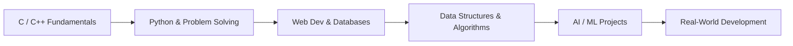

<!-- ===================== HEADER BANNER ===================== -->
<p align="center">
  
</p>

<!-- ===================== TYPING ANIMATION ===================== -->
<p align="center">
  <a href="https://shirishshinde.is-a.dev">
    
  </a>
</p>

<!-- ===================== BADGES ===================== -->
<p align="center">
  
  
  
</p>

<p align="center">
  <a href="https://shirishshinde.is-a.dev" target="_blank">
    
  </a>
  <a href="https://github.com/MasterShirishShinde" target="_blank">
    
  </a>
  
</p>

<p align="center">
  <i>I turn curiosity into code, learn by building, and improve with every project.</i>
</p>

---

## 👨‍💻 About Me

<table>
  <tr>
    <td width="55%" valign="top">

```yaml
name:        Shirish Satish Shinde
pronouns:    He/Him
education:   Diploma in Computer Engineering (3rd Year)
interests:   [Coding, AI, ML, Emerging Tech]
motivation:  Strong fundamentals, real problems, work I'm proud of
portfolio:   shirishshinde.is-a.dev
mindset:     Progress > Perfection
```

  </td>
  <td width="45%" valign="top">

I'm a dedicated learner passionate about **programming, software development, AI and machine learning**.

Right now I'm sharpening my core technical skills, deepening my understanding of computer science, and building projects that grow my **confidence, consistency and problem-solving ability**.

I learn by doing, improve through mistakes, and stay consistent until the results show. 💪

  </td>
  </tr>
</table>

---

## 🎯 What I'm Focused On

| 🔭 Focus | 📖 Details |
|---|---|
| 💻 **Coding Fundamentals** | Writing clean, logical, efficient code |
| 🧠 **Computer Science Base** | Solid grounding in CS and software development |
| 🤖 **AI & ML** | Exploring modern technologies and intelligent systems |
| 🛠️ **Real Projects** | Practical, clean and meaningful builds |
| 📈 **Step-by-step Growth** | Getting better as a developer every single day |

---

## 🚀 Featured Work

<table>
  <tr>
    <td width="50%" valign="top">
      <h3>📌 C_Programming</h3>
      <p>
        C and C++ practice, logic building and core programming concepts. It strengthens my problem-solving foundation and shows me how code works at a deeper level.
      </p>
      <p>
        
        
      </p>
      <p><a href="https://github.com/MasterShirishShinde" target="_blank">View repository →</a></p>
    </td>
    <td width="50%" valign="top">
      <h3>📌 Python_Programming</h3>
      <p>
        My Python learning space for writing cleaner code, experimenting with ideas and growing toward more advanced development work.
      </p>
      <p>
        
      </p>
      <p><a href="https://github.com/MasterShirishShinde" target="_blank">View repository →</a></p>
    </td>
  </tr>
</table>

---

## 🛠️ Tech Stack

<p align="center">
  
</p>

<details>
<summary><b>🔎 Skill breakdown</b></summary>
<br>

| Area | Technologies |
|---|---|
| **Languages** |       |
| **Web** |     |
| **Databases** |   |
| **Tools** |    |

</details>

---

## 📊 GitHub Stats

<p align="center">
  
  
</p>

<p align="center">
  
</p>

<p align="center">
  
</p>

<p align="center">
  
</p>

---

## 🐍 Contribution Snake

<p align="center">
  <picture>
    <source media="(prefers-color-scheme: dark)" srcset="https://raw.githubusercontent.com/MasterShirishShinde/MasterShirishShinde/output/github-snake-dark.svg" />
    <source media="(prefers-color-scheme: light)" srcset="https://raw.githubusercontent.com/MasterShirishShinde/MasterShirishShinde/output/github-snake.svg" />
    
  </picture>
</p>

---

## 🌱 Currently Learning

- 🧩 Stronger problem-solving with **C, C++ and Python**
- 🌐 **Web development** basics and frontend structure
- 🗄️ **Database** concepts and practical implementation
- ⚙️ **Core CS concepts** that make code efficient and reliable
- 🗂️ Better **project planning, structure and presentation**

### 🗺️ My Roadmap



---

## 💡 My Approach

> *"Good developers are built through consistency, curiosity and practice."*

1. 📚 Learn the fundamentals properly
2. 🛠️ Build small, useful projects
3. 🔍 Review mistakes and improve
4. 🔁 Stay consistent even when progress feels slow

That mindset helps me grow not only as a student, but as someone preparing for real-world development work.

---

## 🤝 Let's Connect

<p align="center">
  <a href="https://shirishshinde.is-a.dev" target="_blank">
    
  </a>
  <a href="https://github.com/MasterShirishShinde" target="_blank">
    
  </a>
</p>

<p align="center">
  I'm always open to learning, collaboration and meaningful conversations about coding, technology and building things that matter. ✨
</p>

<p align="center">
  
</p>

<!-- ===================== FOOTER ===================== -->
<p align="center">
  
</p>
